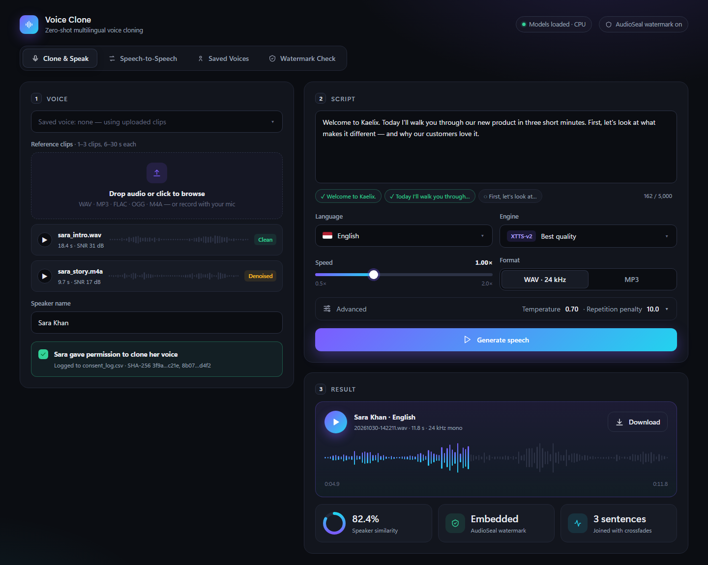

# Voice Clone: local multilingual zero-shot voice cloning

Upload 6–30 s of a speaker, type text, pick one of 17 languages, and get speech in that speaker's voice.
Everything runs locally. Every output carries an imperceptible **AudioSeal** watermark, and nothing is
cloned without a logged **consent** record.



| Tab | What it does |
|---|---|
| **Clone & Speak** | 1–3 reference clips (upload or record) → text → language / engine / speed → watermarked WAV or MP3 + speaker-similarity score |
| **Speech-to-Speech** | Record yourself saying a line; it is re-voiced as the target speaker with your timing and emotion intact (OpenVoice v2) |
| **Live Voice Chat** | Hands-free, Siri-style conversation: you talk, Claude writes a reply, and it is spoken back in a saved voice |
| **Saved Voices** | Store a processed speaker profile with cached XTTS latents / OpenVoice embeddings, so you don't re-upload |
| **Watermark Check** | Upload any audio and see whether it carries this app's watermark |

Design docs: [wireframes](docs/wireframes/) · [mockups](docs/mockups/) · [screenshots of the running app](docs/screenshots/)

## Setup

Requirements: Python 3.10–3.13, ~6 GB disk for models, 16 GB RAM recommended. An NVIDIA GPU is optional;
it's picked up automatically and makes generation 10–20× faster.

**Windows**
```bat
run.bat
```
**Linux / macOS**
```bash
./run.sh
```

The first run creates `.venv`, installs pinned dependencies, then starts the app at
**http://127.0.0.1:7860**. The first generation downloads the models (~2.5 GB) to the Hugging Face / TTS cache.

Manual install:
```bash
python -m venv .venv
.venv/Scripts/pip install torch==2.8.0 torchaudio==2.8.0 --index-url https://download.pytorch.org/whl/cpu   # or /whl/cu128 for NVIDIA
.venv/Scripts/pip install -r requirements.txt
set COQUI_TOS_AGREED=1      # = you accept the Coqui Public Model License (see below)
.venv/Scripts/python app.py
```

Optional: install [FFmpeg](https://ffmpeg.org/) to load `.m4a` / `.aac` / `.webm` reference clips. WAV, FLAC,
OGG and MP3 work without it.

### Windows Smart App Control

If Smart App Control is on, Windows silently blocks freshly released native wheels ("An Application Control
policy has blocked this file"). `requirements.txt` pins `pandas` and `monotonic-alignment-search` to older,
established builds for this reason. If you upgrade packages and hit the error, pin the named package back.

### Slow or unreliable internet

If the first-run model download stalls, fetch the files with `curl` (it resumes after drops) into the
folders the app checks first:

```bash
cd models/xtts_v2      # config.json, vocab.json, speakers_xtts.pth, model.pth (~1.9 GB)
curl -L -C - -O https://huggingface.co/coqui/XTTS-v2/resolve/main/model.pth   # repeat for each file
cd ../whisper-small    # config.json, tokenizer.json, vocabulary.txt, model.bin (~480 MB)
curl -L -C - -O https://huggingface.co/Systran/faster-whisper-small/resolve/main/model.bin
```

## Live Voice Chat

A hands-free voice call with a saved voice: speak, pause, and the reply comes back in that voice.

```
mic → speech detection → Whisper (local) → Claude Opus 5.5 (streamed) → XTTS-v2 (streamed, cloned voice) → speakers
```

1. Save the voice in **Saved Voices** first (that's where consent is recorded).
2. Get an API key at <https://console.anthropic.com>, then set it before starting the app:
   ```bat
   set ANTHROPIC_API_KEY=sk-ant-...
   run.bat
   ```
3. Open **Live Voice Chat**, pick the voice, and describe their personality, way of talking and shared memories.
   The AI improvises from this, so the more specific it is, the more natural it sounds.
4. Press **Start talking**, stay quiet for a second while it measures room noise, then talk. **Use headphones**
   so it doesn't hear itself.

Things to know:
- **It's an AI, not the person.** It sounds like them, but Claude writes the words. It won't make plans or
  promises on their behalf, and it says it's the AI version if you sincerely ask.
- **Speed: it needs an NVIDIA GPU to feel like a conversation.** Measured on an i7-1265U laptop (CPU only), XTTS
  runs ~15x slower than real time: a short sentence takes ~35 s, so each reply arrives after half a minute or
  more. On CPU it plays whole sentences, so the wait is long but playback is smooth. On an NVIDIA GPU (RTX 3060 or
  better) XTTS generates faster than real time and reply audio streams while it's being generated.
- **Privacy:** speech-to-text and voice generation run locally. Only the text of the conversation goes to
  Anthropic's API. Claude Opus 5.5 runs at low effort for snappy replies, with server-side refusal fallback on.
- **Urdu/Hindi:** speak normally; replies are written in Devanagari so the Hindi voice can read them.
- Turn-taking is one at a time: it doesn't listen while it's talking, so wait for it to finish.

## Test

```bash
.venv/Scripts/python tests/smoke_test.py
```
End to end, using a built-in XTTS voice as the "speaker": consent gate blocks → generate with XTTS (WAV)
and OpenVoice (MP3) → watermark detected → unwatermarked audio not flagged → similarity is plausible.

## Recording a good reference clip

- **10–20 s of continuous, natural speech.** Under 6 s sounds generic; past 30 s adds nothing (it's trimmed).
- **Quiet room, no music, no echo.** Soft furnishings beat a bare room. The app denoises, but it can't
  recover a voice buried in noise; you'll get a warning when the estimated SNR is under 15 dB.
- **Mic 15–25 cm away**, slightly off-axis to avoid plosive pops. A phone voice memo is fine.
- **Speak the way you want the output to sound.** Reading flatly gives flat clones; calm conversational
  speech generalizes best. The clip's language doesn't have to match the output language.
- **Multiple clips** (up to 3) of the same person in different sentences give a more robust voice.
- No clipping: keep peaks below max, the app normalizes loudness anyway.

## Languages

English, Spanish, French, German, Italian, Portuguese, Polish, Turkish, Russian, Dutch, Czech, Arabic,
Chinese, Japanese, Hungarian, Korean, Hindi (all XTTS-v2 languages).

**Urdu (approximate):** type Roman Urdu (`aap kaise hain`) or Devanagari, and it's spoken through XTTS's Hindi
mode. Expect a Hindi accent and occasional mispronunciation. Urdu script (Nastaliq) is rejected in this mode.
For real Urdu, fine-tune the model: see **[FINETUNE_URDU.md](FINETUNE_URDU.md)**. The app then shows an
extra "XTTS-v2 Urdu (fine-tuned)" engine that reads Urdu script.

## Quality knobs

- Long text is split into sentences (per-language limits), generated one by one, and joined with 250 ms
  pauses and 15 ms fades, so there are no clicks.
- **Temperature** (default 0.7): lower = steadier and more monotone, higher = more expressive with a risk of artifacts.
- **Repetition penalty** (default 10): raise it if words or sounds repeat or babble.
- Output is 24 kHz mono, loudness-normalized, as WAV or MP3.

## Engines

| Engine | How | Best for |
|---|---|---|
| **XTTS-v2** (primary) | Zero-shot GPT + HiFi-GAN conditioned on the reference | Highest similarity and naturalness |
| **OpenVoice v2** | A built-in XTTS voice speaks the text, then the OpenVoice tone-color converter re-voices it | Faster voice switching; also powers Speech-to-Speech |

Engines share one interface (`engines/__init__.py: Engine`), so adding another means implementing
`make_voice()` and `tts()`.

## Project layout

```
app.py                 Gradio UI (5 tabs)
ui_theme.py            dark studio theme, CSS and result cards
voice_chat.py          live voice chat loop (mic → Whisper → Claude → XTTS → speakers)
consent.py             consent gate + consent_log.csv (timestamp, speaker, SHA-256 of each clip)
engines/               common interface, sentence split/join, xtts_engine.py, openvoice_engine.py
audio/preprocess.py    load any format → mono → 24 kHz → denoise → trim → loudness-normalize, with warnings
audio/watermark.py     AudioSeal embed + detect (16-bit app ID)
eval/similarity.py     SpeechBrain ECAPA speaker similarity, 0–100 %
finetune/              Common Voice Urdu prep, XTTS GPT training, export
tests/smoke_test.py    end-to-end check
```

## Responsible use

- Generation is blocked until the speaker's name is entered and permission is confirmed. Each clip's
  SHA-256 is logged with a UTC timestamp in `consent_log.csv` (git-ignored; it holds personal data).
- All output is watermarked. Detection survives MP3 compression and moderate edits, but not every attack:
  treat it as a signal, not proof.
- Never use this to impersonate, defraud, or deceive. Cloning a voice without consent may be illegal where you live.

## Licences

| Component | Licence | Commercial use? |
|---|---|---|
| This app's code | [MIT](LICENSE) | yes |
| [coqui-tts](https://github.com/idiap/coqui-ai-TTS) 0.28 (maintained Coqui fork) | MPL-2.0 | yes |
| **XTTS-v2 weights** | **[Coqui Public Model License](https://coqui.ai/cpml)** | **No: non-commercial only.** Coqui shut down in 2024, so a commercial licence can no longer be bought. |
| OpenVoice v2 (code + weights) | MIT | yes |
| AudioSeal (code + weights) | MIT | yes |
| SpeechBrain + ECAPA-VoxCeleb | Apache-2.0 | yes |
| Gradio | Apache-2.0 | yes |
| faster-whisper + Whisper small | MIT | yes |
| Claude API (Live Voice Chat) | [Anthropic commercial terms](https://www.anthropic.com/legal/commercial-terms) | yes, pay-per-use |

`COQUI_TOS_AGREED=1` in `run.bat` / `run.sh` means **you** accept the CPML. Because the OpenVoice engine uses an
XTTS voice as its base speaker, a fully commercial setup would need a different base TTS (e.g. MeloTTS, MIT).
